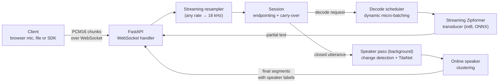

# Streaming ASR with Online Speaker Diarization

[](https://github.com/mustafizur118/streaming-asr-diarization/actions/workflows/ci.yml)

A real-time speech-to-text service that also says **who** is speaking. Audio streams in over a
WebSocket; partial transcripts come back while the person is still talking, and each finished
utterance comes back with a speaker label (`S1`, `S2`, …). It runs on CPU with ONNX Runtime and
needs no GPU.

Real output on one of the 3-speaker test conversations, recognition errors included (`python clients/stream_wav.py`):

```
[   0.42-   5.33] S1: Ester asked for a summary of every meeting in one place the transcript looks good but...
[   5.46-  11.65] S2: That sounds reasonable but we should measure it first most of the delay comes from wa...
[  12.41-  15.00] S1: The battery drains quickly when the microphone stays open
[  15.80-  18.83] S2: Thanks that answers my question about the pricing
[  19.63-  24.82] S1: Jubod cash the results or compete them every time the new model handles noisy fun cal...
[  25.15-  31.55] S3: The support team gets a lot of calls on monday morning I tried the new settings and t...
```

**Results** (2-vCPU cloud VM, no GPU; details and caveats in [Benchmarks](#benchmarks)):

| | |
|---|---|
| Word error rate, synthetic conversations | 8.8% |
| Diarization error rate (0.25 s collar) | 11.9% (without in-utterance speaker-change detection: 44.6%) |
| Real-time factor, one stream | 0.22 |
| Partial-transcript latency, p50 / p95 | 42 / 71 ms with 1 stream; 62 / 159 ms with 4 concurrent streams |
| Unit tests | 29, no model download needed (fakes), run in CI |

## Contents
- [How it works](#how-it-works)
- [Quick start](#quick-start)
- [WebSocket API](#websocket-api)
- [Benchmarks](#benchmarks)
- [Design decisions](#design-decisions)
- [Limitations and next steps](#limitations-and-next-steps)
- [Project layout](#project-layout)

## How it works



1. **Streaming recognition.** Each connection gets its own stream on a shared streaming Zipformer
   transducer (sherpa-onnx, int8). Partial text is pushed whenever it changes.
2. **Endpointing with carry-over.** An utterance closes after 0.8 s of silence following the last
   token. Tokens are emitted with a short delay, so the next utterance can already have started
   inside that window. The stream is not reset; a new one is opened and the audio after the last
   token is replayed into it. With `reset()`, those first words were lost in testing.
3. **Dynamic micro-batching.** Sessions do not call the model directly. They queue their streams
   with a scheduler that decodes everything waiting (up to 16 streams, or whatever arrives within
   4 ms) in one ONNX call on a dedicated thread, so the event loop never blocks.
4. **Speaker pass, off the audio path.** A closed utterance is labelled by a background task, in
   order, while new audio keeps flowing:
   - **Change detection.** Endpointing only cuts on pauses, so a quick exchange between two people
     can land in one utterance. The pass embeds 1.5 s windows (0.25 s hop) with NVIDIA NeMo
     TitaNet-small and marks a speaker change where neighbouring windows disagree (cosine
     similarity < 0.55 at a local minimum). Each change is snapped to the longest pause between
     words nearby, so no word is split. Token times trail the audio by about 0.2 s, and that lag is
     corrected first.
   - **Online clustering.** Each speaker segment of at least 1 s is embedded and joins the closest
     known speaker if cosine similarity is at least 0.65. Otherwise it starts a new one. Centroids
     are duration-weighted running means. Shorter segments inherit the previous speaker.
5. **Any client sample rate.** Browsers usually capture at 48 kHz. Input is converted to 16 kHz
   once, with a streaming (stateful) libsoxr resampler, so chunk edges leave no artifacts.

## Quick start

```bash
git clone https://github.com/mustafizur118/streaming-asr-diarization
cd streaming-asr-diarization
pip install -e ".[client]"
bash scripts/download_models.sh      # ~340 MB, from the sherpa-onnx GitHub releases
rtspeech-server --port 8000
```

Open <http://localhost:8000> to talk into the microphone or stream an audio file, or use the
command-line client:

```bash
python clients/stream_wav.py path/to/audio.wav          # paced in real time
python clients/stream_wav.py path/to/audio.wav --fast   # as fast as possible
```

Docker:

```bash
docker build -t streaming-asr-diarization .
docker run --rm -p 8000:8000 streaming-asr-diarization
```

Configuration is by environment variable (`ENDPOINT_SILENCE`, `SPEAKER_THRESHOLD`,
`CHANGE_THRESHOLD`, `MAX_SPEAKERS`, `NUM_THREADS`, `MAX_BATCH`, …); see
[`src/rtspeech/config.py`](src/rtspeech/config.py).

## WebSocket API

Connect to `ws://HOST:8000/v1/stream?sample_rate=16000` (8, 16, 22.05, 24, 32, 44.1 or 48 kHz).

| Direction | Message | Meaning |
|---|---|---|
| client → server | binary | mono PCM, signed 16-bit little-endian, at most 2 s per message |
| client → server | `{"type": "eof"}` | end of input: flush and close |
| server → client | `{"type": "ready", ...}` | stream accepted |
| server → client | `{"type": "partial", "utterance": 3, "text": "...", "audio_end": 12.4}` | running hypothesis |
| server → client | `{"type": "final", "segment": 5, "utterance": 3, "text": "...", "start": 10.2, "end": 12.1, "speaker": "S2", "speaker_score": 0.81, "new_speaker": false}` | labelled segment |
| server → client | `{"type": "done", "audio_seconds": ..., "speakers": [...], "real_time_factor": ...}` | after `eof` |

`GET /healthz` is the liveness check. `GET /metrics` reports active sessions, real-time factor,
chunk processing latency (p50/p95) and the mean decode batch size.

## Benchmarks

Reproduce with `make bench` (it needs `scripts/download_models.sh --bench` for the TTS voice).

**Data.** Real multi-speaker corpora with labels (AMI, VoxConverse) are large and licence-bound, so
the benchmark synthesises conversations whose speakers, timings and text are known exactly. It
uses a multi-speaker Piper voice (904 LibriTTS-R speakers) and sentences written for the project.
Each conversation has 2-4 speakers and 8-12 turns. Gaps between turns are 0.3-1.5 s, so some turns
follow each other faster than the endpointer can cut. Thresholds were tuned on a separate **dev**
set (seed 1, 4 conversations); the numbers below are from the **test** set (seed 7, 12
conversations, 8.3 minutes). Synthetic speech is cleaner than real recordings, so read these
as optimistic. Real-speech accuracy is the next thing to measure (see below).

Hardware: Intel Xeon @ 2.10 GHz, 2 logical cores, no GPU. Streaming Zipformer transducer (int8), TitaNet-small
speaker embeddings, ONNX Runtime on CPU. Raw numbers: [`bench/results/results.json`](bench/results/results.json).

| Metric | Full system | Without in-segment change detection |
|---|---|---|
| WER | 8.8% | 8.8% |
| DER (no collar) | 22.1% | 55.3% |
| DER (0.25 s collar) | 11.9% | 44.6% |
| Correct number of speakers | 67% | 25% |
| Real-time factor, 1 stream | 0.216 | 0.170 |

Real speech: WER 0.0% on the 3 LibriSpeech test utterances shipped with the model (77 words; a smoke test, not a benchmark).

Live WebSocket latency (100 ms chunks sent in real time, 30 s per stream):

| Concurrent streams | Partial latency p50 / p95 | Utterance finalization delay p50 / p95 |
|---|---|---|
| 1 | 42.5 / 70.8 ms | 1519.7 / 3071.4 ms |
| 2 | 50.8 / 99.5 ms | 1774.3 / 3348.6 ms |
| 4 | 61.5 / 158.9 ms | 2636.8 / 4646.5 ms |
| 6 | 392.8 / 724.2 ms | 4654.7 / 6034.6 ms |
| 8 | 963.5 / 3699.9 ms | 7889.8 / 12256.8 ms |

Partial latency: time from sending a chunk to receiving the partial transcript that includes it. Utterance finalization delay: time from the end of an utterance's speech to its speaker-labelled final result; it includes the 0.8 s of silence the endpointer waits for. When two people talk without a pause, both turns are labelled together when that utterance closes.

**Speed vs. accuracy knob.** `CHANGE_HOP` sets the spacing of the change-detection windows. The
default 0.25 s gives the accuracy above. With 0.5 s, test-set DER (0.25 s collar) rises to 18.2%,
but the embedding thread competes less for CPU under load: p95 partial latency at 6 concurrent
streams drops from 724 ms to 251 ms
([`results_change_hop_0.5.json`](bench/results/results_change_hop_0.5.json)).

**Ablation.** In-utterance speaker-change detection is what makes the diarization usable. Without
it, DER (0.25 s collar) goes from 11.9% to 44.6%, and the correct number of speakers is found
in 25% of conversations instead of 67%. It adds work: the real-time factor rises from
0.17 to 0.22. Moving the detection to a background task keeps that cost off the partial
transcript path.

**Capacity.** On this 2-vCPU machine the service handles about 4 concurrent real-time streams with
p95 partial latency under 200 ms. At 6-8 streams the two cores are saturated (one stream alone runs
at a real-time factor of 0.22 using two ONNX threads) and queues build. More cores, the 0.5 s hop,
or moving speaker embeddings to their own worker pool would raise that limit.

## Design decisions

- **Transducer + endpointing instead of chunked Whisper.** A streaming transducer emits text
  frame by frame with constant memory, and it gives token timestamps that the speaker pass reuses
  to place boundaries. Whisper-style models need re-decoding of overlapping windows to fake
  streaming.
- **Online (incremental) clustering instead of offline clustering.** Offline spectral or
  agglomerative clustering at the end of a call is more accurate, but a live caption needs a label
  now. Leader-follower clustering with running centroids is O(speakers) per segment and never
  relabels the past.
- **Carry-over instead of `reset()`.** See [How it works](#how-it-works), step 2. A unit test
  (`test_speech_starting_inside_the_endpoint_window_is_not_lost`) guards this.
- **Micro-batching on one decode thread.** One worker owns the model; batching amortises the
  per-call overhead across users and keeps ONNX Runtime's intra-op threads from fighting between
  requests.
- **Ordered background labelling.** The speaker pass for utterance *n* can take 100+ ms on long
  utterances. Running it inline would stall that client's audio. Running it unordered could swap
  labels. A chain of tasks gives both: no stall, and ordered output.
- **Testable without models.** The ASR backend and embedder are small interfaces; the tests use a
  fake recogniser (one token per 0.3 s of non-silence) and a fake embedder (tones as voices). They
  cover the session, scheduler, segmenter, clustering, metrics and the WebSocket server in about
  2 s.

## Limitations and next steps

- **Overlapping speech** is not separated: one speaker label per segment.
- **Evaluation on real conversations.** The next step is AMI / VoxConverse-style recordings, with
  noise, far-field microphones and crosstalk.
- **Japanese and other languages.** The ASR wrapper accepts any sherpa-onnx streaming transducer;
  no Japanese model has been evaluated yet.
- **Speaker identity across sessions** (enrolment, "this is Alice") is not implemented: labels are
  per session.
- **GPU / Triton serving** is untested; the scheduler is where a GPU batch path would plug in.

## Project layout

```
src/rtspeech/
  server.py      FastAPI app: WebSocket endpoint, health, metrics, demo page
  session.py     per-connection state: endpointing, carry-over, ordered labelling
  scheduler.py   dynamic micro-batching of decode calls
  asr.py         sherpa-onnx streaming transducer wrapper (+ protocol for fakes)
  segmenter.py   speaker-change detection and pause-snapped splitting
  speaker.py     TitaNet embedder and online clustering
  audio.py       PCM conversion, streaming resampler
web/index.html   browser demo (microphone or file, AudioWorklet capture)
clients/         command-line streaming client
bench/           data generator, threshold tuning (dev set), benchmark (test set)
tests/           model-free unit tests
```

## Background

I research speaker-identity protection against zero-shot voice cloning at JAIST (Unoki
Laboratory), where speaker-verification models like TitaNet are used to *measure* identity. This
project uses the same family of embeddings on the serving side, to *track* identity live.

## Acknowledgements and licence

Code: MIT. Pretrained models are downloaded from their upstream releases and keep their own
licences: the streaming Zipformer English model (k2-fsa/icefall, exported by sherpa-onnx), NVIDIA
NeMo TitaNet-small (ONNX export by sherpa-onnx) and the Piper `en_US-libritts_r-medium` voice
(benchmark only).
